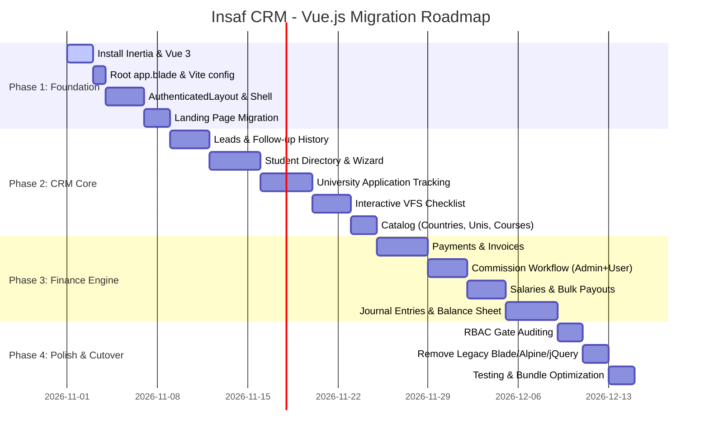

# Vue.js Migration Plan: Insaf Educancy ERP & CRM

> **Target Framework**: Vue.js 3 (Composition API, `<script setup>`, ESNext)  
> **Primary Architecture**: **Inertia.js + Vue 3** (Laravel Full-Stack SPA)  
> **Status**: Ready for Future Implementation  
> **Author**: AI Assistant  
> **Date**: October 2026  

---

## 1. Executive Summary & Feasibility

### Can this project be converted to Vue.js?
**Yes, 100%.** The application is currently a monolithic Laravel 12 application utilizing Blade templates, Alpine.js, and jQuery (`Select2`, `perfect-scrollbar`).

Converting the frontend to Vue 3 with **Inertia.js** delivers:
- **True SPA Speed**: Instant page navigation without full-page browser reloads.
- **Data Integrity**: Retains 100% of existing Laravel controllers, FormRequests, Eloquent models, DB transactions, and security policies.
- **Component Reusability**: Unified Vue components for datatables, modal dialogs, status badges, cascading dropdowns, and multi-step forms.
- **Clean Architecture**: Eliminates scattered Alpine.js attributes, mixed inline JavaScript, and jQuery dependencies in favor of typed, reactive Vue 3 components.

---

## 2. Architecture Comparison

| Evaluation Metric | Option A: Inertia.js + Vue 3 (Recommended) | Option B: Decoupled REST API + Vue 3 SPA | Option C: Hybrid Vue Islands in Blade |
| :--- | :--- | :--- | :--- |
| **Backend Modification** | **Minimal**: Return `Inertia::render()` instead of `view()` | **Extensive**: Rewrite all 26+ controllers to API resources | **None**: Keep Blade views |
| **RBAC & Gate Checks** | **100% Preserved**: Native Laravel `can:*role` routes work seamlessly | **Replaced**: Sanctum token auth, client-side route guards | **100% Preserved**: Native Laravel |
| **Form & Error Handling** | **Automated**: Inertia's `useForm` binds validation errors automatically | **Manual**: Custom Axios interceptors & manual error binding | **Blade/Old**: Server-rendered errors |
| **Implementation Time** | **2–3 Weeks** (Phased) | **6–8 Weeks** (Full rewrite) | **1–2 Weeks** (Partial) |
| **SPA Feel** | **Full SPA**: Seamless client-side transitions | **Full SPA**: Client-side routing with Vue Router | **Partial**: Multi-page reloads remain |

---

## 3. Technology Stack Specification

| Category | Recommended Tool | Version | Purpose |
| :--- | :--- | :--- | :--- |
| **Framework** | **Vue.js** | `^3.5.0` | Frontend UI framework (Composition API) |
| **Adapter** | **@inertiajs/vue3** | `^2.0.0` | Laravel-to-Vue full-stack adapter |
| **Build Tool** | **Vite** + `@vitejs/plugin-vue` | `^7.0.0` | Lightning-fast HMR and bundle compilation |
| **Styling** | **Tailwind CSS** | `^4.0.0` | Utility-first CSS already configured in project |
| **Component Primitives** | **Radix Vue** / **Shadcn-vue** | Latest | Accessible unstyled primitives (Dialog, Select, Dropdown) |
| **Icons** | **lucide-vue-next** | Latest | Modern, clean vector icons |
| **Form Management** | **Inertia `useForm`** | Built-in | Two-way binding, error handling, progress indicator |
| **State Management** | **Pinia** | `^2.2.0` | Global client UI state (theme, sidebar, active filters) |
| **Notifications** | **vue-sonner** | Latest | Toast alerts for CRUD operations & flash messages |
| **Charts** | **Chart.js** / **vue-chartjs** | Latest | Financial charts, balance sheet summaries, lead metrics |

---

## 4. Target Project Directory Structure

```
resources/
├── css/
│   └── app.css                             # Tailwind CSS setup & global theme tokens
├── js/
│   ├── app.js                              # Inertia app initialization & Vue mount
│   ├── Composables/                        # Shared utility functions
│   │   ├── usePermissions.js               # User role/privilege checks matching backend can()
│   │   ├── useCurrency.js                  # Currency formatting using system settings
│   │   ├── useDate.js                      # Standard date formatting
│   │   └── useFlash.js                     # Flash message listener
│   ├── Layouts/
│   │   ├── AuthenticatedLayout.vue         # Main Admin Layout (Sidebar, Header, Notifications)
│   │   ├── GuestLayout.vue                 # Auth pages (Login, Forgot Password, 2FA)
│   │   └── PublicLayout.vue                # Public landing page layout
│   ├── Components/
│   │   ├── UI/                             # Button, Input, Select, Badge, Modal, Card
│   │   ├── Tables/                         # Dynamic DataTable, Pagination, SearchFilter
│   │   ├── Forms/                          # CascadingSelect, DocumentUpload, DatePicker
│   │   └── Widgets/                        # StatCard, BalanceWidget, NotificationBell
│   └── Pages/
│       ├── Landing.vue                     # Converted Public Landing Page
│       ├── Dashboard/
│       │   └── Index.vue                   # Dashboard KPIs & analytics
│       ├── Students/
│       │   ├── Index.vue                   # Searchable student directory with filter pills
│       │   ├── CreateEdit.vue              # Multi-step student profile form
│       │   └── Show.vue                    # Student dossier, documents, linked applications
│       ├── Applications/
│       │   ├── Index.vue                   # University applications list
│       │   ├── CreateEdit.vue              # Application intake & fee allocation
│       │   └── Show.vue                    # Application progress, fee status, checklist link
│       ├── VfsChecklist/
│       │   ├── Index.vue                   # Checklist summary & student overview
│       │   ├── Show.vue                    # Interactive checklist with audit trail
│       │   └── Templates.vue               # Checklist templates configuration
│       ├── Finance/
│       │   ├── Payments/
│       │   │   ├── Index.vue               # Payment transactions list
│       │   │   └── CreateEdit.vue          # Payment collection modal / form
│       │   ├── Commissions/
│       │   │   ├── Index.vue               # Accountant commission review & approvals
│       │   │   └── MyCommissions.vue       # Employee commission claim self-service
│       │   ├── Expenses/
│       │   │   └── Index.vue               # Office expense tracking & categorization
│       │   ├── Salaries/
│       │   │   ├── Index.vue               # Payroll index & export actions
│       │   │   └── Generate.vue            # Bulk salary calculator & payout dialog
│       │   ├── Invoices/
│       │   │   ├── Index.vue               # Invoices directory
│       │   │   └── CreateEdit.vue          # Dynamic invoice line-item builder
│       │   ├── JournalEntries/
│       │   │   ├── Index.vue               # General ledger transactions
│       │   │   └── Create.vue              # Balanced double-entry creation form
│       │   └── Reports/
│       │       ├── Summary.vue             # Financial income/expense summary
│       │       └── BalanceSheet.vue        # Interactive balance sheet with date filter
│       └── Marketing/
│           ├── Leads/
│           │   ├── Index.vue               # Lead board & conversion actions
│           │   └── Show.vue                # Lead follow-up history
│           ├── Campaigns/
│           │   └── Index.vue               # Marketing campaigns & asset management
│           └── Documents/
│               └── Index.vue               # SOP, CV, Cover Letter templates
└── views/
    └── app.blade.php                       # Single Inertia HTML entry root
```

---

## 5. Phased Implementation Roadmap



### Phase 1: Foundation & Application Shell
1. **Dependencies Installation**:
   ```bash
   composer require inertiajs/inertia-laravel
   npm install @inertiajs/vue3 vue @vitejs/plugin-vue pinia lucide-vue-next vue-sonner clsx tailwind-merge
   ```
2. **Vite Configuration**:
   Update `vite.config.js` to register `vue()` plugin and alias `@` to `resources/js`.
3. **Inertia Middleware**:
   Run `php artisan inertia:middleware`, register `HandleInertiaRequests` in `bootstrap/app.php`.
   Share global props: `auth.user`, `auth.roles`, `auth.permissions`, flash messages, and `app_settings`.
4. **Root View**:
   Create `resources/views/app.blade.php` containing `@inertiaHead` and `@inertia`.
5. **Layout & Navigation**:
   Build `AuthenticatedLayout.vue` with collapsible sidebar, active route highlighting, header search, dark mode toggle, and notification dropdown.
6. **Landing Page**:
   Convert `resources/views/landing.blade.php` into `resources/js/Pages/Landing.vue`.

### Phase 2: CRM Core Modules
1. **Leads Management**:
   - Convert `LeadController` to return `Inertia::render('Marketing/Leads/Index')`.
   - Real-time follow-up history modal and one-click "Convert to Student" action.
2. **Student Management**:
   - Replace old form with a modern Vue tabbed/stepper profile builder.
   - Reactive cascading dropdown: Country ➔ University ➔ Course ➔ Course Intake (no jQuery Select2).
   - Drag-and-drop document uploader with progress tracking.
3. **Application & VFS Checklist**:
   - Interactive VFS Checklist with instant reactive check/uncheck toggles, notes modal, and live progress bar.
   - Application status and fee breakdown pill components.

### Phase 3: Finance & Accounting Engine
1. **Payments & Billing**:
   - Modal-driven payment recording with live application balance calculation.
   - Invoice builder with reactive line items (`subtotal = qty * rate`, auto tax, discount, total calculation).
2. **Commission Portal**:
   - Dual interface:
     - Employee view (`MyCommissions.vue`): View eligible applications, submit claims with notes.
     - Accountant view (`Commissions/Index.vue`): Filter pending claims, propose adjusted amount, approve/reject with feedback.
3. **Payroll & Salaries**:
   - Interactive monthly salary generator with editable inline bonus/overtime/deduction fields.
   - Modal for bulk payment execution that triggers expense records and ledger adjustments.
4. **General Ledger & Financial Reports**:
   - Journal Entry creator with real-time `Total Debit === Total Credit` validation before enabling submit.
   - Interactive Balance Sheet with expandable parent/child chart-of-accounts rows and date range picker.

### Phase 4: Quality Assurance, Security, & Deprecation
1. **RBAC Verification**: Validate that all page actions check the `usePermissions` composable matching backend permissions.
2. **Asset Cleanup**: Safely delete legacy Blade templates under `resources/views/admin/` and unused vendor assets in `public/assets/` (`jquery`, `select2`, `perfect-scrollbar`).
3. **Performance Optimization**: Dynamic import of Vue routes for minimal initial load bundle size.

---

## 6. Controller Conversion Example

### Traditional Blade Pattern:
```php
namespace App\Http\Controllers\Admin;

use App\Models\Student;
use Illuminate\Http\Request;

class StudentController extends Controller
{
    public function index(Request $request)
    {
        $students = Student::with(['country', 'university', 'course'])
            ->when($request->search, function ($q, $search) {
                $q->where('first_name', 'like', "%{$search}%")
                  ->orWhere('email', 'like', "%{$search}%");
            })
            ->latest()
            ->paginate(15);

        return view('admin.students.index', compact('students'));
    }
}
```

### Modernized Inertia + Vue 3 Pattern:
```php
namespace App\Http\Controllers\Admin;

use App\Models\Student;
use Illuminate\Http\Request;
use Inertia\Inertia;
use Inertia\Response;

class StudentController extends Controller
{
    public function index(Request $request): Response
    {
        $students = Student::with(['country:id,name', 'university:id,name', 'course:id,name'])
            ->when($request->search, function ($q, $search) {
                $q->where('first_name', 'like', "%{$search}%")
                  ->orWhere('email', 'like', "%{$search}%");
            })
            ->latest()
            ->paginate(15)
            ->withQueryString();

        return Inertia::render('Students/Index', [
            'students' => $students,
            'filters'  => $request->only(['search', 'stage', 'status']),
        ]);
    }
}
```

---

## 7. Migration Checklist for Future Execution

- [ ] Run `composer require inertiajs/inertia-laravel`
- [ ] Install npm packages: `@inertiajs/vue3`, `vue`, `@vitejs/plugin-vue`, `pinia`, `lucide-vue-next`
- [ ] Configure `vite.config.js` with Vue plugin and aliases
- [ ] Create `HandleInertiaRequests` middleware and register in `bootstrap/app.php`
- [ ] Create `resources/views/app.blade.php`
- [ ] Build `resources/js/Layouts/AuthenticatedLayout.vue` and `GuestLayout.vue`
- [ ] Migrate Public Landing Page (`landing.blade.php` ➔ `Pages/Landing.vue`)
- [ ] Migrate Authentication screens (Login, 2FA, Password Reset)
- [ ] Migrate CRM Core: Leads, Students, Applications, VFS Checklist
- [ ] Migrate Finance: Payments, Invoices, Commissions, Salaries, Journal Entries, Balance Sheet
- [ ] Deprecate Blade views and remove legacy jQuery/Alpine dependencies
- [ ] Run test suite (`php artisan test`) and verify all workflows
